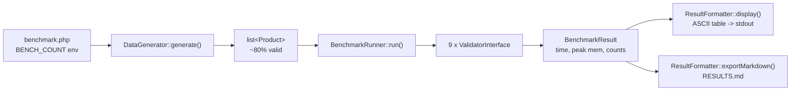
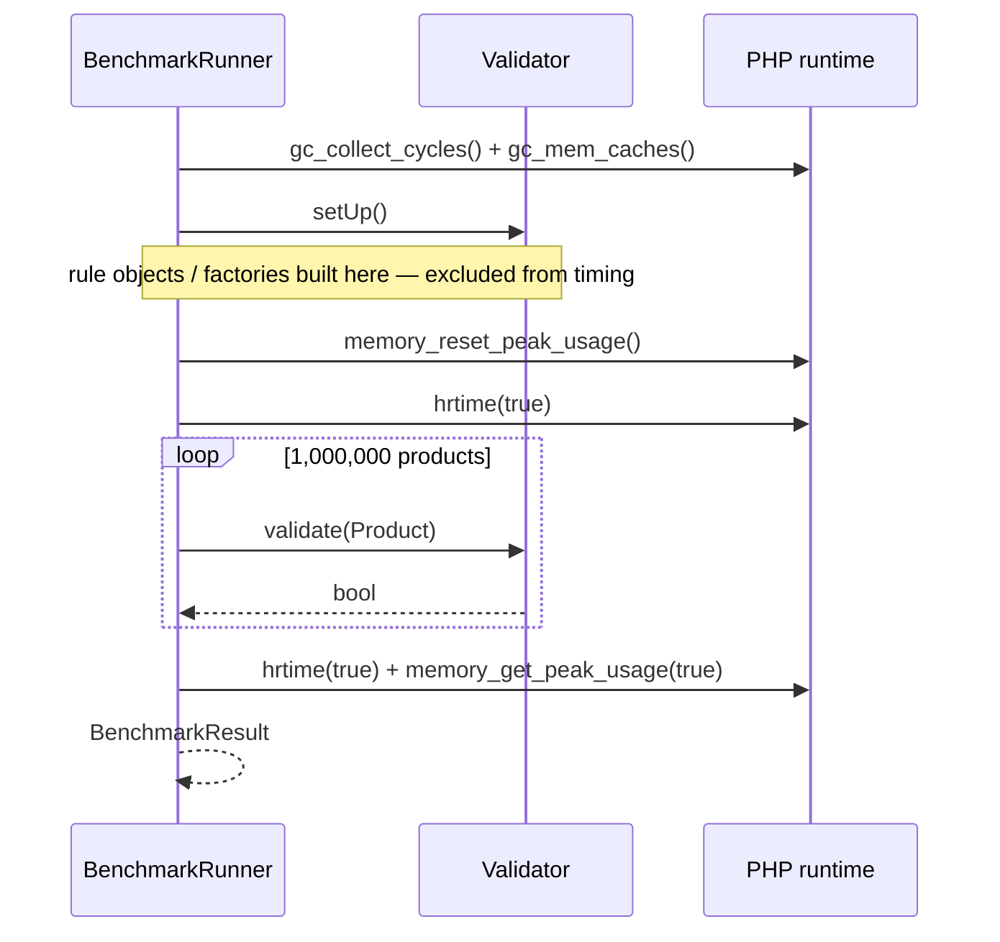
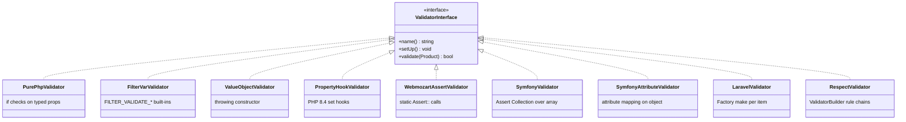
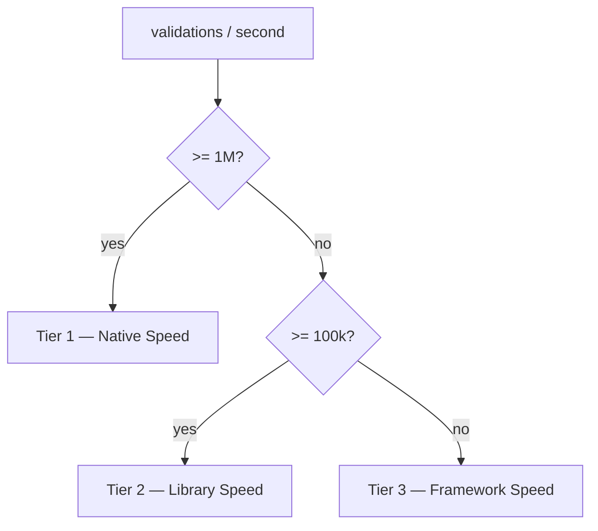

# php-validator-benchmarks

Nine ways to validate the same object, measured on the same data, in the same container.
One million `Product { sku, price, quantity, active }` items per validator, PHP 8.5, Docker.

Full generated report: **[RESULTS.md](RESULTS.md)** (regenerated on every run).

---

## What it measures

Every approach answers one question — *is this product valid?* — under identical rules:

| Field | Rule |
|---|---|
| `sku` | non-empty string |
| `price` | `> 0` |
| `quantity` | `>= 0` |
| `active` | bool |

The dataset is ~80% valid / ~20% invalid, with defects spread evenly across empty SKU, negative
price and negative quantity. All validators must return the same valid/invalid counts — that
equality is the correctness check.

---

## How it works



The data is generated **once** and reused by every validator, so the comparison measures
validation cost only — not object construction or RNG.

### Per-validator measurement loop



`setUp()` is deliberately outside the timed window: building a Symfony validator or a Respect
rule chain is a one-time cost in real apps, so only the per-item work is measured.

---

## The nine approaches



| Validator | Mechanism | Backing class |
|---|---|---|
| Pure PHP | `if` on typed properties | — |
| filter_var() | `FILTER_VALIDATE_FLOAT` / `_INT` | — |
| Value Objects | throwing constructor | `ProductValueObject` |
| Property Hooks | PHP 8.4 `set` hooks | `PropertyHookedProduct` |
| webmozart/assert | `Assert::*` + `try/catch` | — |
| Symfony Validator | `Assert\Collection` over array | — |
| Symfony Attributes | attribute mapping on object | `ValidatedProduct` |
| Laravel Validation | `Factory::make()->passes()` | — |
| Respect Validation | `ValidatorBuilder` chains | — |

---

## Results

1,000,000 items, PHP 8.5.9, `php:8.5-cli-alpine`. `RESULTS.md` holds the latest single run; the
range column below is the spread across three runs on the same machine:

| Validator | Validations/s (latest) | Range over 3 runs | vs Pure PHP |
|---|---:|---:|---:|
| Pure PHP | 15,181,573/s | 8.25M – 15.18M | 1x |
| Value Objects | 4,546,604/s | 1.39M – 4.55M | 3–6x slower |
| webmozart/assert | 4,186,224/s | 1.39M – 4.19M | 4–6x slower |
| filter_var() | 3,605,772/s | 1.70M – 3.61M | 4–5x slower |
| Property Hooks | 2,740,082/s | 1.25M – 2.74M | 6–7x slower |
| Respect Validation 3.1 | 207,293/s | 92k – 207k | 73–92x slower |
| Symfony Attributes 8.1 | 98,180/s | 38k – 98k | 155–224x slower |
| Symfony Validator 8.1 | 78,138/s | 25k – 78k | 194–337x slower |
| Laravel Validation 12 | 13,758/s | 6.4k – 13.8k | 1100–1290x slower |

All nine agreed on the verdict every run (799,674 valid / 200,326 invalid in the latest; the data
set is regenerated per run, so the split moves).

Absolute rates move a lot between runs — the third run was roughly 2x faster across the board than
the first two, machine load being the obvious suspect. Ratios against that run's own Pure PHP
baseline stayed put, which is why the last column is the number to read.

Four things worth noting:

- **Positions 2–5 are not stable.** The harness runs each validator once, and consecutive runs swap
  that ordering freely — webmozart/assert and Value Objects have each taken second place across the
  three runs above. Treat everything inside a tier as "roughly the same speed".
- **The tier boundary is the real result.** Every hand-rolled approach clears 1.2M/s; every
  library-driven one stays under 210k/s. That gap is far wider than the run-to-run noise.
- **Respect 3.x is far slower than Respect 2.x was** on this workload. v3 evaluates every rule into a
  `Result` object instead of short-circuiting on a bool, so each field allocates. Against the
  pure-PHP baseline of its own run, v2 sat at ~8x slower; v3 sits at 73–92x. (Different hardware
  between those runs, hence the ratio rather than the raw rate.)
- **Laravel's cost is architectural**, not incidental: `Factory::make()` builds a fresh `Validator`
  (plus translator lookups) per item, which is exactly how request validation uses it. It is also the
  most repeatable number in the table.

See [RESULTS.md](RESULTS.md) for the generated report — charts, memory, per-tier breakdown.

Tiers are derived from measured throughput, not hardcoded:



---

## Run it

```bash
# Docker (recommended) — builds the image, writes RESULTS.md next to the repo
./run.sh

# Custom output directory
./run.sh /path/to/results

# Smaller/larger dataset
BENCH_COUNT=50000 ./run.sh

# Different PHP series (image tag php:<version>-cli-alpine)
PHP_VERSION=8.4 ./run.sh

# Local PHP (needs PHP >= 8.5)
composer install
BENCH_COUNT=100000 php benchmark.php
```

Environment variables:

| Var | Default | Effect |
|---|---|---|
| `BENCH_COUNT` | `1000000` | items generated and validated |
| `RESULTS_DIR` | script dir (`/results` in Docker) | where `RESULTS.md` is written |
| `PHP_VERSION` | `8.5` | Docker base image tag (`run.sh` only) |

---

## Layout

```
benchmark.php              entry point — generate, run, report
src/
  Product.php              input DTO (readonly)
  DataGenerator.php        dataset generation + byte formatting
  BenchmarkRunner.php      timing + memory harness
  BenchmarkResult.php      one result row
  ResultFormatter.php      ASCII table + RESULTS.md export
  ProductValueObject.php   throwing-constructor variant
  PropertyHookedProduct.php property-hook variant
  ValidatedProduct.php     Symfony attribute variant
  Validators/              the nine ValidatorInterface implementations
Dockerfile                 php:${PHP_VERSION}-cli-alpine + composer install
run.sh                     build + run + collect results
```

---

## Reading the numbers honestly

- **Throughput is not the whole story.** Laravel and Symfony buy you error messages,
  translation, nested rules and framework integration. This benchmark prices that convenience;
  it does not say it is not worth paying.
- **`setUp()` costs are excluded.** Laravel still pays a per-item `Validator` construction inside
  the loop, because that is how it is used in practice.
- **Peak memory is `memory_get_peak_usage(true)`** — real allocator pages, dominated by the 1M
  product array itself, so deltas between validators are small by construction.
- **Same machine, same run.** Absolute numbers depend on hardware and PHP build; ratios travel
  better than seconds.
- **One sample per validator.** There is no warmup and no repetition — each validator is timed once,
  in a fixed order, in a single process. Observed run-to-run spread is up to ~1.6x on the fast
  approaches, which is smaller than the tier gaps but larger than the gaps between neighbours. Run it
  a few times before drawing conclusions about any single ranking.

## Adding a validator

1. Implement `Bench\Validators\ValidatorInterface` in `src/Validators/`.
2. Add a strategy/cost note to `ResultFormatter::NOTES` (keyed by `name()`).
3. Register the instance in the `$validators` array in `benchmark.php`.

Tier placement and all charts follow automatically from the measured throughput.
