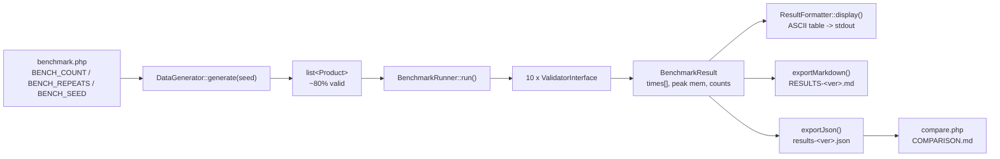
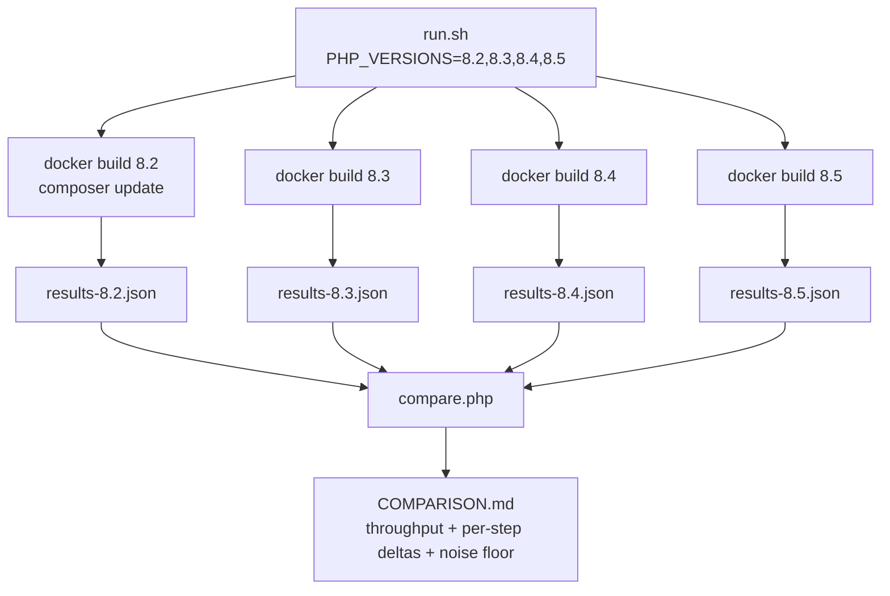
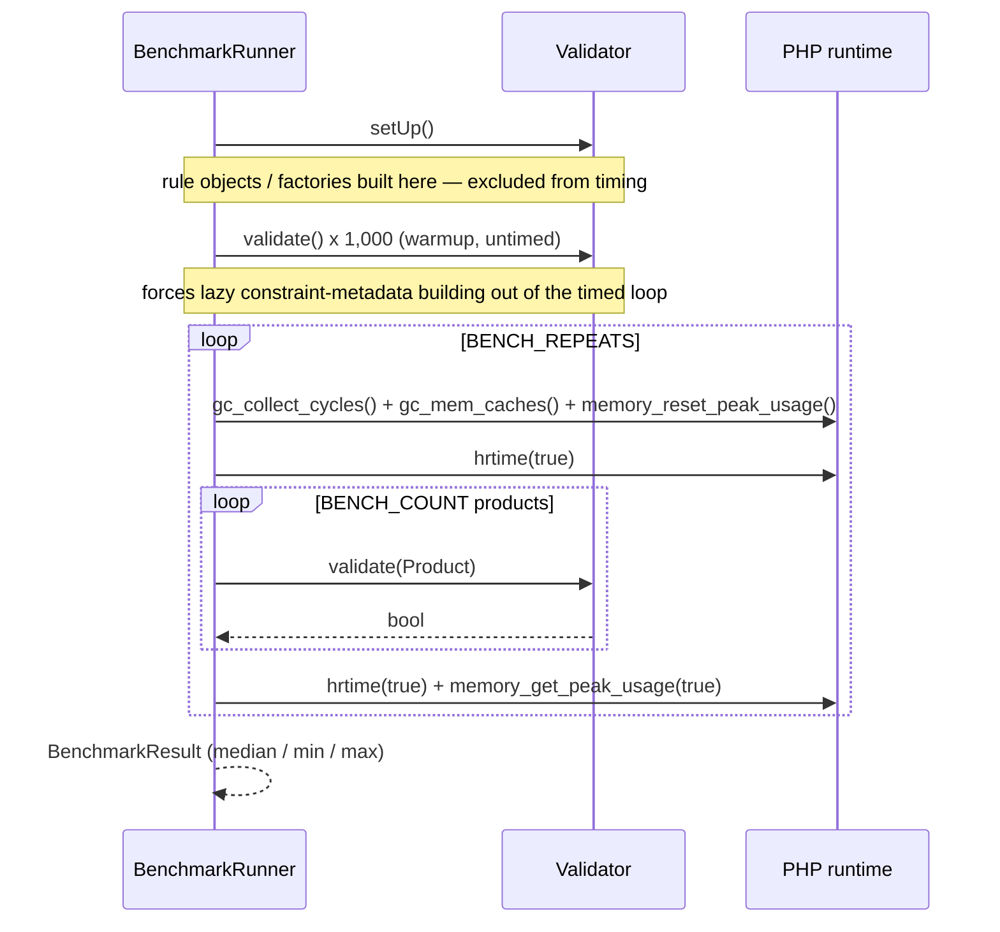
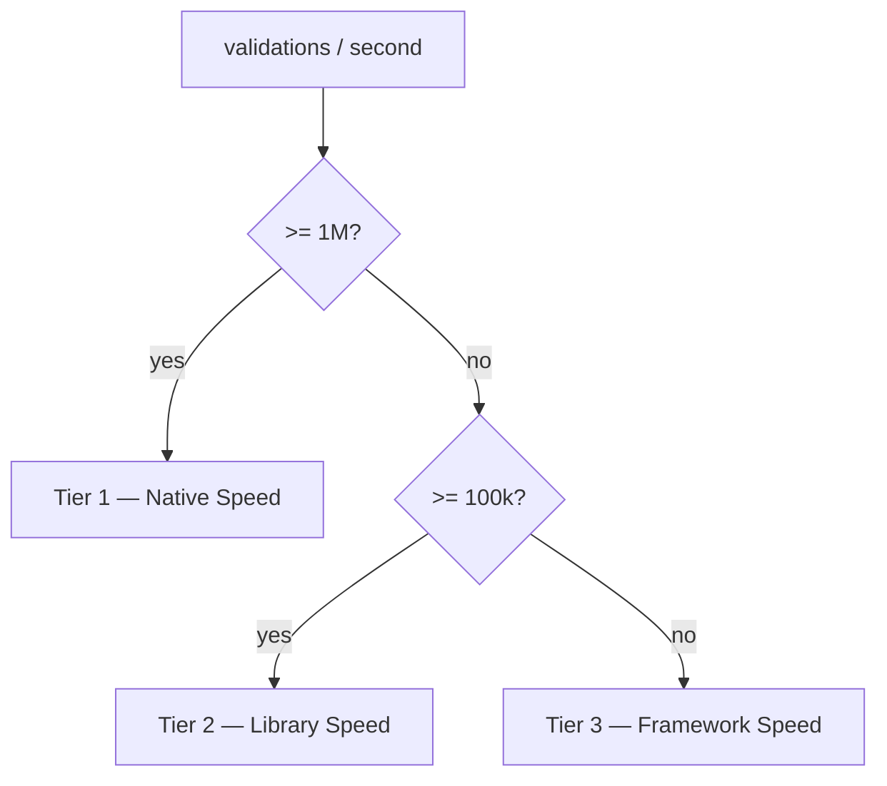

# php-validator-benchmarks

Ten ways to validate the same object, measured on the same data, in the same container —
across **PHP 8.2, 8.3, 8.4 and 8.5**. `Product { sku, price, quantity, active }` items,
seeded dataset, Docker.

Generated reports:

- **[results/COMPARISON.md](results/COMPARISON.md)** — cross-version diff: what got faster, what got slower
- **[results/RESULTS.md](results/RESULTS.md)** — newest PHP version in the matrix (copy of `RESULTS-8.5.md`)
- `results/RESULTS-<version>.md` / `results/results-<version>.json` — one per PHP version

---

## What it measures

Every approach answers one question — *is this product valid?* — under identical rules:

| Field | Rule |
|---|---|
| `sku` | non-empty string |
| `price` | `> 0` |
| `quantity` | `>= 0` |
| `active` | bool |

The dataset is ~80% valid / ~20% invalid, with defects spread evenly across empty SKU, negative
price and negative quantity. All validators must return the same valid/invalid counts — that
equality is the correctness check.

---

## How it works



The data is generated **once** per run and reused by every validator, so the comparison measures
validation cost only — not object construction or RNG. The generator is seeded, so every PHP
version in the matrix validates a byte-identical dataset.

### The version matrix



There is **no `composer.lock`**: each image resolves the newest libraries its PHP version
supports, which is the point of the "should I upgrade" question. Each run records the versions it
actually got, and `COMPARISON.md` flags every row where the library moved as well as the runtime.

### Per-validator measurement loop



`setUp()` is deliberately outside the timed window: building a Symfony validator or a Respect
rule chain is a one-time cost in real apps, so only the per-item work is measured. The warmup pass
does the same for lazily-built constraint metadata. Each validator is then timed `BENCH_REPEATS`
times and reported by **median**, with the min–max spread printed next to it as that row's noise
floor (shown as `n/a (1 repeat)` when `BENCH_REPEATS=1`).

---

## The ten approaches

```mermaid
classDiagram
    class ValidatorInterface {
        <<interface>>
        +name() string
        +setUp() void
        +validate(Product) bool
    }

    class PurePhpValidator {
        if checks on typed props
    }
    class FilterVarValidator {
        FILTER_VALIDATE_* built-ins
    }
    class ValueObjectValidator {
        throwing constructor
    }
    class PropertyHookValidator {
        PHP 8.4 set hooks
    }
    class WebmozartAssertValidator {
        static Assert:: calls
    }
    class SymfonyValidator {
        Assert Collection over array
    }
    class SymfonyAttributeValidator {
        attribute mapping on object
    }
    class LaravelValidator {
        Factory make per item
    }
    class ValinorValidator {
        MapperBuilder::map()
    }
    class RespectV3Validator {
        ValidatorBuilder chains (PHP 8.5)
    }
    class RespectV2Validator {
        static v:: chains (PHP 8.2-8.4)
    }

    ValidatorInterface <|.. PurePhpValidator
    ValidatorInterface <|.. FilterVarValidator
    ValidatorInterface <|.. ValueObjectValidator
    ValidatorInterface <|.. PropertyHookValidator
    ValidatorInterface <|.. WebmozartAssertValidator
    ValidatorInterface <|.. SymfonyValidator
    ValidatorInterface <|.. SymfonyAttributeValidator
    ValidatorInterface <|.. LaravelValidator
    ValidatorInterface <|.. ValinorValidator
    ValidatorInterface <|.. RespectV3Validator
    ValidatorInterface <|.. RespectV2Validator
```



Two of the ten are version-conditional: **Property Hooks** only exists on PHP 8.4+ (the class is
8.4 syntax and cannot be parsed on 8.2/8.3, so it is skipped there), and **Respect Validation** is
implemented twice because 3.x requires PHP 8.5 — both report the same validator name so the
comparison lines them up.

| Validator | Mechanism | Backing class |
|---|---|---|
| Pure PHP | `if` on typed properties | — |
| filter_var() | `FILTER_VALIDATE_FLOAT` / `_INT` | — |
| Value Objects | throwing constructor | `ProductValueObject` |
| Property Hooks | PHP 8.4 `set` hooks | `PropertyHookedProduct` |
| webmozart/assert | `Assert::*` + `try/catch` | — |
| Symfony Validator | `Assert\Collection` over array | — |
| Symfony Attributes | attribute mapping on object | `ValidatedProduct` |
| Laravel Validation | `Factory::make()->passes()` | — |
| Valinor | `MapperBuilder::map()` + throwing constructor | `ValinorProduct` |
| Respect Validation | `ValidatorBuilder` chains (3.x) / static `v::` chains (2.x) | — |

---

## Results

200,000 items, 3 timed repeats, seed `20260804`, one Docker image per PHP version, same machine.
Numbers below are the **fastest of the three repeats** (interference only ever slows a sample);
full detail, including the noise floor per row, is in [results/COMPARISON.md](results/COMPARISON.md).

| Validator | PHP 8.2 | PHP 8.3 | PHP 8.4 | PHP 8.5 | 8.2 → 8.5 |
|---|---:|---:|---:|---:|---:|
| Pure PHP | 29,322,082/s | 23,258,671/s | 25,104,005/s | 22,316,797/s | −23.9% |
| Value Objects | 6,596,835/s | 6,418,904/s | 5,384,255/s | 6,152,334/s | −6.7% |
| webmozart/assert | 5,642,589/s | 5,714,268/s | 5,584,459/s | 5,825,855/s | +3.2% |
| filter_var() | 3,908,480/s | 4,109,257/s | 3,744,761/s | 3,680,007/s | −5.8% |
| Property Hooks | n/a | n/a | 3,936,840/s | 4,102,236/s | — |
| Respect Validation ⚠️ | 2,770,897/s | 2,814,479/s | 2,868,964/s | 213,797/s | **−92.3%** |
| Symfony Attributes ⚠️ | 133,212/s | 134,408/s | 119,502/s | 120,990/s | −9.2% |
| Symfony Validator ⚠️ | 111,315/s | 109,980/s | 98,086/s | 98,785/s | −11.3% |
| Valinor | 107,879/s | 104,159/s | 106,973/s | 91,517/s | −15.2% |
| Laravel Validation | 16,424/s | 16,875/s | 17,219/s | 14,717/s | −10.4% |

⚠️ = the library version changed with the PHP version, so that row is runtime **plus** library.
All ten returned the same verdict split on every version: 160,169 valid / 39,831 invalid.

What the matrix actually says:

- **This run is noisier than a bare-metal comparison.** Pure PHP alone had a 146% spread on PHP 8.2
  (see the noise floor table in `COMPARISON.md`) — contention from running the whole matrix
  back-to-back on one shared machine. Treat any single-digit-percent delta above as within the
  noise floor, not a finding; only rows with a large, consistent move across versions are real.
- **Respect is still the one big, real number.** −92.3% is `respect/validation` 2.5 → 3.1, which
  only installs on PHP 8.5. v3 evaluates every rule into a `Result` object instead of
  short-circuiting on a bool, so each field allocates. Staying on 2.x keeps Respect in the
  ~2.8M/s range; the drop is the library upgrade, not the runtime.
- **Valinor lands in the same tier as Symfony, slightly behind it.** `MapperBuilder::map()` builds
  a full mapping tree and validates through reflection-derived type info, so throughput
  (~90k–110k/s) sits close to `Symfony Validator`/`Symfony Attributes` rather than near the
  hand-rolled or `Value Objects` tier — the cost is the generic mapping machinery, not just the
  two `\RuntimeException` checks in `ValinorProduct`.
- **Library-driven validation barely tracks the PHP runtime.** Laravel, the Symfony rows, and
  Valinor all move by roughly the same amount PHP 8.2 → 8.5 as they do version-to-version inside
  the noise floor — their cost is dominated by per-item object/reflection overhead that PHP's own
  performance work doesn't touch.

See [results/RESULTS.md](results/RESULTS.md) for the newest version's full report — charts, memory,
per-tier breakdown — or `results/RESULTS-8.2.md` … `results/RESULTS-8.5.md` for the others.

Tiers are derived from measured throughput, not hardcoded:



---

## Run it

```bash
# Full matrix: builds one image per PHP version, writes to ./results/
./run.sh

# Single version
PHP_VERSIONS=8.5 ./run.sh

# Pick your own set
PHP_VERSIONS=8.3,8.5 ./run.sh

# Custom output directory
./run.sh /path/to/results

# Bigger dataset, more repeats (wall clock scales with both)
BENCH_COUNT=1000000 BENCH_REPEATS=5 ./run.sh

# Local PHP (>= 8.2), single version only
composer update
BENCH_COUNT=100000 BENCH_REPEATS=3 php benchmark.php
php compare.php .            # needs >= 2 results-*.json files
```

Environment variables:

| Var | Default | Effect |
|---|---|---|
| `PHP_VERSIONS` | `8.2,8.3,8.4,8.5` | comma-separated matrix (`run.sh` only) |
| `PHP_VERSION` | — | legacy single-version alias for `PHP_VERSIONS` |
| `BENCH_COUNT` | `200000` via `run.sh`; `1000000` via `php benchmark.php` | items generated and validated |
| `BENCH_REPEATS` | `3` via `run.sh`; `1` via `php benchmark.php` | timed repeats per validator; per-version `RESULTS-*.md` report the median, `COMPARISON.md` the best. With 1 repeat the spread shows as `n/a (1 repeat)` |
| `BENCH_SEED` | `20260804` | dataset seed — keep fixed to compare versions |
| `RESULTS_DIR` | `./results` (`/results` in Docker) | where reports are written |

---

## Layout

```
benchmark.php              entry point — generate, run, report one PHP version
compare.php                reads results-*.json -> COMPARISON.md
src/
  Product.php              input DTO (readonly)
  DataGenerator.php        seeded dataset generation + byte formatting
  BenchmarkRunner.php      warmup + repeated timing + memory harness
  BenchmarkResult.php      one result row (median/min/max over repeats)
  ValidatorSet.php         the validators run on this PHP version (forThisRuntime())
  Environment.php          PHP series + resolved library versions
  ResultFormatter.php      ASCII table + RESULTS-<ver>.md + results-<ver>.json
  ComparisonFormatter.php  cross-version tables, deltas, library-drift flags
  ProductValueObject.php   throwing-constructor variant
  PropertyHookedProduct.php property-hook variant (PHP 8.4+ syntax)
  ValidatedProduct.php     Symfony attribute variant
  Validators/              the ValidatorInterface implementations
tests/                     PHPUnit: rule boundaries, validator agreement, generator, runner
Dockerfile                 php:${PHP_VERSION}-cli-alpine + composer update
run.sh                     build + run the matrix + compare
```

---

## Reading the numbers honestly

- **Throughput is not the whole story.** Laravel and Symfony buy you error messages,
  translation, nested rules and framework integration. This benchmark prices that convenience;
  it does not say it is not worth paying.
- **`setUp()` costs are excluded.** Laravel still pays a per-item `Validator` construction inside
  the loop, because that is how it is used in practice.
- **Peak memory is `memory_get_peak_usage(true)`** — real allocator pages, dominated by the
  product array itself, so deltas between validators are small by construction.
- **Same machine, same run.** Absolute numbers depend on hardware and PHP build; ratios travel
  better than seconds. Compare columns within one `COMPARISON.md`, not across runs.
- **The noise floor is printed, not assumed.** Each validator is timed `BENCH_REPEATS` times and the
  min–max spread appears in every report. A version-to-version delta smaller than that row's spread
  is not a result — `COMPARISON.md` has a dedicated table for exactly this check.
- **Library versions move with the PHP version.** `symfony/validator` 8.x needs PHP >= 8.4.1 and
  `respect/validation` 3.x needs PHP >= 8.5, so the 8.2/8.3 columns run Symfony 7.4 and Respect 2.x.
  Those rows are marked ⚠️ in `COMPARISON.md`: the delta there is runtime *plus* library.
- **Property Hooks has no 8.2/8.3 number** by construction — the feature does not exist there.

## Adding a validator

1. Implement `Bench\Validators\ValidatorInterface` in `src/Validators/`.
2. Add a strategy/cost note to `ResultFormatter::NOTES` (keyed by `name()`).
3. Register the instance in `ValidatorSet::forThisRuntime()` (`src/ValidatorSet.php`, used by `benchmark.php` and the tests) — guard it with a
   `PHP_VERSION_ID` or `class_exists()` check if it cannot run on every version in the matrix.
4. If it is library-backed, map `name() => package` in `Environment::PACKAGES` so version drift
   gets flagged in `COMPARISON.md`.

Tier placement and all charts follow automatically from the measured throughput.
